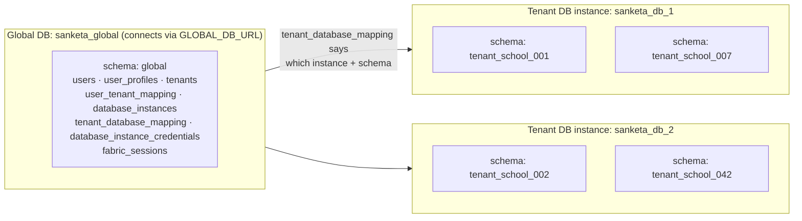
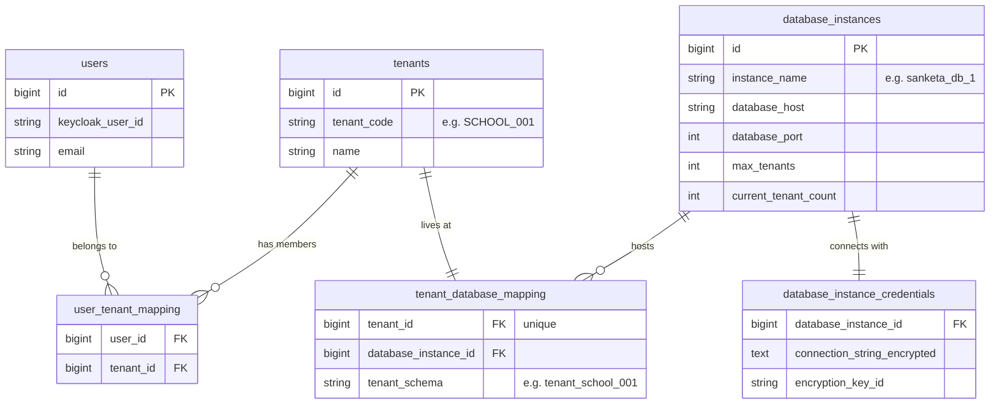
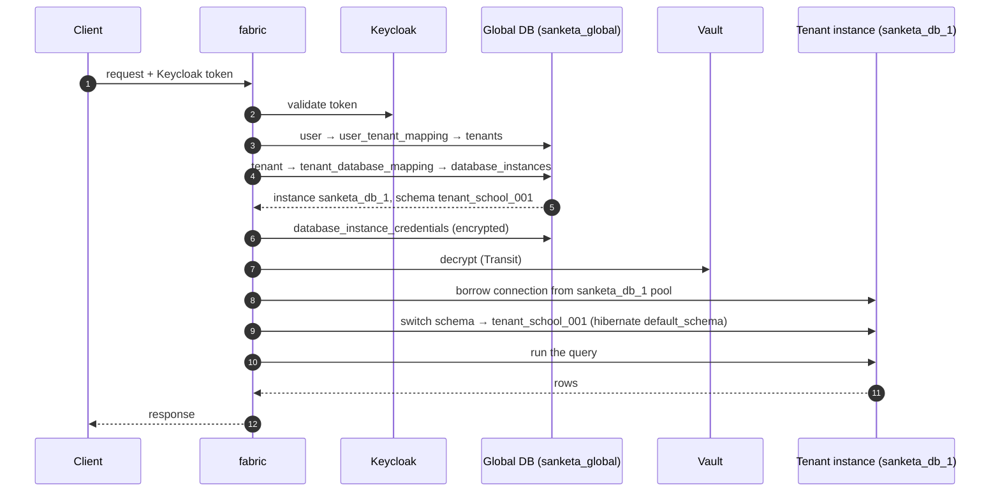
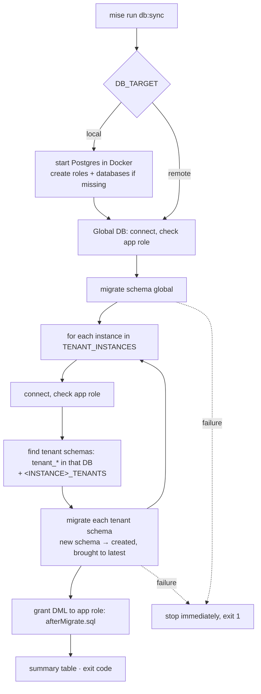
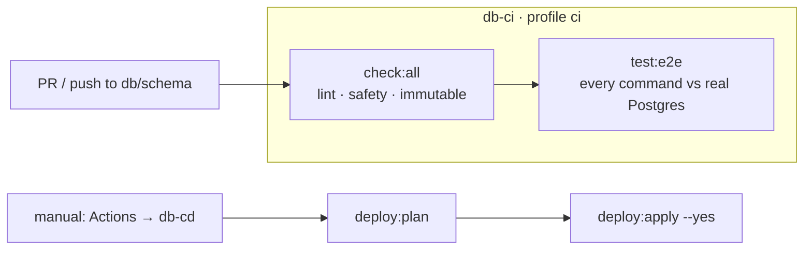

# sanketa-db

Source of truth for Sanketa's PostgreSQL schemas, versioned with Flyway.

- [Getting started](#getting-started): two commands
- [Commands](#commands): everything you can run (or just type `mise run`)
- [Profiles and configuration](#profiles-and-configuration): one file per environment
- [Architecture](#architecture): what `fabric` expects and how this repo maps onto it
- [CI/CD](#cicd)
- [Rules that are enforced](#rules-that-are-enforced)

---

## Getting started

Requires **Docker** and **[mise](https://mise.jdx.dev)** (`brew install mise`). Flyway, psql and pg_dump all run in containers; mise installs the remaining tools (sqlfluff) itself.

```bash
git checkout db/schema
mise trust && mise install     # first time only
mise run dev:start             # Postgres up, databases + roles, migrate, seed
```

After that, **you don't need to remember commands**:

| Type | Get |
|---|---|
| `mise run` | an interactive menu of every command: type to filter, Enter to run |
| `mise tasks` | the full list with descriptions |
| `mise run <command> --help` | that command's options and arguments |
| `mise run dev:doctor` | what's wrong with your setup, and how to fix it |

Commands that need a value you didn't pass (which instance? which scope?) ask for it with a numbered list.

## Commands

| Group | Command | What it does |
|---|---|---|
| **dev** | `dev:start` | Start Postgres, create databases and roles, migrate, seed, print connection info |
| | `dev:stop` | Stop Postgres (keeps data) |
| | `dev:reset` | Wipe local data and rebuild (asks first; `--yes` to skip) |
| | `dev:status` | Is it running, and every schema's version vs the files on disk |
| | `dev:doctor` | Check Docker, ports, config, secrets, tools; prints fixes |
| | `dev:psql` | SQL shell; pick the database from a list |
| **db** | `db:new` | New migration from the template (`--concurrent-index` for a safe index file) |
| | `db:sync` | Apply pending migrations: global, then every tenant on every instance |
| | `db:check` | List pending migrations, changing nothing (exit 3 if any) |
| | `db:dump` | Schema-only snapshot to `snapshots/<profile>/`, commit it to review structure changes |
| | `db:diff` | Prove every tenant schema is identical; `--against <profile>` compares with snapshots |
| | `db:repair` | After fixing a failed migration, clear its failed entry (the error message prints the exact command) |
| **tenant** | `tenant:list` | Every school: instance, schema, version, status |
| | `tenant:add` | Create a school's schema on an instance and bring it to latest |
| **data** | `data:seed` | Load seed data (only where the profile allows it) |
| **check** | `check:lint` | SQL style (sqlfluff); `--fix` to auto-format |
| | `check:safety` | Flags risky DDL: non-concurrent indexes, unsafe `NOT NULL`, drops/renames, FKs without index, … |
| | `check:immutable` | Merged migrations were not edited |
| | `check:all` | All checks; run before pushing (CI runs the same) |
| **test** | `test:e2e` | Full end-to-end suite on a throwaway copy (~4 min; CI runs it) |
| **deploy** | `deploy:config` | The fully resolved config of a profile, passwords masked |
| | `deploy:plan` | Read-only: what would be applied, where |
| | `deploy:apply` | Plan → confirm (type the profile name) → optional snapshot → apply → verify |

Write a migration in practice:

```bash
mise run db:new tenant "create students"   # edit the file it prints
mise run db:sync                           # apply locally
mise run check:all                         # lint + safety + immutability
mise run db:diff                           # all tenants still identical
```

## Profiles and configuration

Everything is config-driven: **one file per environment**, the same commands everywhere.

```
mise.toml                    shared defaults for every profile (no secrets)
mise.<profile>.toml          that environment's topology + safety switches (committed)
mise.<profile>.local.toml    your personal overrides (git-ignored)
.secrets/<profile>.env       that environment's passwords (git-ignored)
```

| Profile | Where | Notes |
|---|---|---|
| `dev` *(default)* | your laptop, Docker on port 5433 | seeds and reset allowed, no confirmations |
| `ci` | GitHub Actions, Docker on port 5434 | same as dev, isolated stack |
| remote (later) | staging / prod servers | create from `config/mise.remote.toml.example` |

Pick a profile per command with `-E`: `mise -E ci run db:check`. Each local profile gets its own container (`sanketa-postgres-<profile>`), volume and port, so they never mix.

**What a profile sets**

| Group | Keys |
|---|---|
| Target | `DB_PROFILE`, `DB_TARGET` (`local` = Docker, started for you; `remote` = existing servers, never created), `DB_SSLMODE`, `LOCAL_PORT` |
| Global DB | `GLOBAL_DB_HOST` `GLOBAL_DB_PORT` `GLOBAL_DB_NAME` `GLOBAL_SCHEMA` `GLOBAL_DB_MIGRATOR_USER` `GLOBAL_DB_APP_ROLE` |
| Tenant instances | `TENANT_INSTANCES=sanketa_db_1,sanketa_db_2`; shared `TENANT_DB_*` defaults; per-instance overrides `<INSTANCE>_HOST` `_PORT` `_NAME` `_SSLMODE` `_MIGRATOR_USER` `_APP_ROLE` (+ `_MIGRATOR_PASSWORD` in secrets), e.g. `SANKETA_DB_2_HOST`; local only: `<INSTANCE>_TENANTS` schools to create |
| Safety | `ALLOW_SEEDS`, `ALLOW_RESET`, `REQUIRE_CONFIRM`, `BACKUP_BEFORE_MIGRATE`, `LOCK_TIMEOUT` |
| Secrets | `SECRETS_SOURCE` = `file` (default) or `env` (CI); `vault` is planned |

Safety switches default to **deny** in `mise.toml`; only `dev` and `ci` opt in. Run `mise run deploy:config` to see exactly what a profile resolves to.

**Secrets.** Only passwords are secret, and they never go in a TOML file (`dev:doctor` checks). For `dev`/`ci`, `.secrets/<profile>.env` is created automatically from `config/secrets.local.example`. For a remote profile, create it by hand, or let CI inject the variables. Moving to Vault later only changes the secrets loader in `scripts/lib.sh`.

**Adding a remote profile (e.g. staging)**

```bash
cp config/mise.remote.toml.example mise.staging.toml    # set hosts, instances
$EDITOR .secrets/staging.env                            # *_PASSWORD keys
mise -E staging run deploy:config                       # check the result
mise -E staging run deploy:plan
mise -E staging run deploy:apply
```

---

## Architecture

Sanketa is multi-tenant: one **tenant** per school. The data is split across two kinds of database, matching what the `fabric` service expects (`database/global_db_schema.sql` and `application.yml` in the backend repo).

### The two kinds of database



| | **Global DB** | **Tenant DB instance** |
|---|---|---|
| Name | `sanketa_global` | `sanketa_db_1`, `sanketa_db_2`, … (`database_instances.instance_name`) |
| How many | exactly one | as many as needed. Add instances to scale horizontally |
| Holds | identity (linked to Keycloak), the list of tenants, **routing**: which tenant lives where | **all school data**: students, teachers, academics, timetable, fees, … |
| Inside it | one schema: `global` | one schema **per school**: `tenant_<code>` (e.g. `tenant_school_001`) |
| Migrations | `migrations/global/` | `migrations/tenant/`, the same files on **every** tenant schema of **every** instance |
| App connects as | `sanketa_global_app` | `sanketa_tenant_app` |
| Migrator | `sanketa_global_migrator` | `sanketa_tenant_migrator` (can be overridden per instance) |

### The routing tables, all in the Global DB



- A **user** can belong to many **tenants**, e.g. a teacher at two schools (`user_tenant_mapping`).
- Each **tenant** lives in exactly one **instance**, in one **schema** (`tenant_database_mapping`). The pair (instance, schema) is unique.
- Each **instance** has capacity limits (`max_tenants`, `current_tenant_count`), so new schools go to an instance with room.
- Instance credentials are stored **encrypted** (`database_instance_credentials`) and decrypted through Vault.

### How a request finds its school's data (inside `fabric`)



`fabric` keeps **one connection pool per instance**, not per school (`sanketa.database.pool.max-size: 50`), and switches schema per request. That's why many schools share an instance cheaply.

### MySQL → PostgreSQL: one naming difference to know

| Concept | MySQL (old `fabric` SQL) | PostgreSQL (this repo) |
|---|---|---|
| Server | host:port | host:port |
| "Database" | **same thing as a schema** | a container that **holds schemas** |
| Global data | database `sanketa_global` | database `sanketa_global` → schema `global` |
| One school | database/schema `tenant_x` on an instance | schema `tenant_x` inside database `sanketa_db_N` |

So in Postgres a tenant instance is **host + port + database name**. `database_instances` today stores only host and port. When it's rewritten as a Postgres migration here, it needs a **`database_name`** column, and `database_type`/`database_port` defaults become `POSTGRESQL`/`5432`.

### Local setup: what `dev:start` creates on your Mac

```
Docker container "sanketa-postgres-dev"  (one server, standing in for several)
│   reachable from your Mac at localhost:5433
│
├── database sanketa_global                  ← Global DB
│     └── schema global
├── database sanketa_db_1                    ← tenant instance 1
│     └── schema tenant_school_001
└── database sanketa_db_2                    ← tenant instance 2
      └── schema tenant_school_002
```

Locally, the "instances" are separate databases on one server. In staging/prod each can be on a different host: only the config changes, not the code.

Isolation is real even locally. `sanketa_tenant_app` **cannot connect** to `sanketa_global`, `sanketa_global_app` cannot connect to any tenant instance, and neither role can create or alter tables.

---

### What `db:sync` does



Every command is idempotent, so running it twice is safe. Exit codes: `0` ok · `1` failure · `2` bad usage · `3` pending (`db:check`).

---

## CI/CD



- **`db-ci.yml`** runs the same `mise run …` commands you run locally: `check:all`, then `test:e2e` (fresh databases, migrations, drift, tenants, safety guards, failure recovery, guarded deploy).
- **`db-cd.yml`** is manual-only for now (no remote environments yet). Inputs: profile and `plan`/`apply`.
  - It needs a committed `mise.<profile>.toml` and a GitHub environment with the same name, whose secrets are the `*_PASSWORD` keys.
  - Add *Required reviewers* to that environment to gate it.
- Only one deploy runs at a time, and a running migration is never cancelled.

### What infra must provision per environment

`docker/postgres/bootstrap.sh` is the exact local equivalent. For each environment:

- **Global DB** `sanketa_global`, with `REVOKE ALL ON DATABASE … FROM PUBLIC` and `REVOKE ALL ON SCHEMA public FROM PUBLIC`
  - `sanketa_global_migrator`: `LOGIN`, `CONNECT, CREATE` on it
  - `sanketa_global_app`: `LOGIN`, `CONNECT`
- **Each tenant instance** `sanketa_db_N`, with the same revokes
  - its migrator: `LOGIN`, `CONNECT, CREATE`
  - `sanketa_tenant_app`: `LOGIN`, `CONNECT`
- App roles never get DDL. Their table grants come from `migrations/callbacks/afterMigrate.sql`, re-applied on every migrate.

---

## Repository layout

```
migrations/global/      V<utc-timestamp>__<desc>.sql (+ R__ for views/functions) → Global DB, schema global
migrations/tenant/      same rules → every tenant schema on every instance
migrations/callbacks/   afterMigrate.sql: app-role grants, every schema, every run
seeds/{global,tenant}/  R__*.sql, idempotent, local/CI only; own history table
templates/              header every migration starts from
mise.toml, mise.<p>.toml shared config + one file per profile (.miserc.toml: default profile)
mise-tasks/<group>/     one small script per command (dev, db, tenant, data, check, deploy)
scripts/                the logic: lib.sh (config, secrets, prompts) · db-sync.sh · schema-dump/diff · tenant-list · check-safety.py · doctor
config/                 secrets.local.example · mise.remote.toml.example
.secrets/               <profile>.env passwords (git-ignored)
snapshots/<profile>/    committed schema dumps for review (db:dump)
tests/safety/           fixtures for the risky-DDL checker
docker/postgres/        bootstrap.sh: local roles + databases (reference for infra)
docs/                   CONVENTIONS.md (read before writing a table) · adr/
```

---

## Rules that are enforced

1. **Merged migrations are immutable.** CI fails on any modify/rename/delete of a merged `V*` file. Fix forward.
2. **Timestamp versions** (`V20261019153000__…`), so parallel branches never collide.
3. **No `clean`.** Flyway's drop-everything command is disabled. Local reset is `dev:reset`, and only where `ALLOW_RESET=true`.
4. **Least privilege, per database.** Migrators run DDL; app roles do DML only, and only on their own kind of database.
5. **Bounded locking.** Every migration session sets `lock_timeout` (default `5s`) and fails fast instead of freezing traffic.
6. **Fail fast across the fleet.** The first failing schema stops the run, so a bad migration never spreads to the remaining schools.
7. **Profiles decide what's allowed.** Seeds, reset and unconfirmed deploys are off unless a profile opts in. Seeds use their own `flyway_seed_history`.
8. **Credentials never in argv or TOML.** Passwords live in `.secrets/` or CI secrets, are passed to containers by name only, and stay masked.
9. **Risky DDL is caught before review.** `check:safety` runs in CI on every new migration.

## Releasing alongside the app

Order per release: **`deploy:apply` (global → every instance) → `fabric` rollout.** Every migration must work with the `fabric` version that's *currently* running (expand → migrate → contract; see `docs/CONVENTIONS.md`).

`fabric` changes needed for Postgres:
- `GLOBAL_DB_URL=jdbc:postgresql://<host>:5432/sanketa_global?currentSchema=global`, driver `org.postgresql.Driver`, connecting as `sanketa_global_app`
- tenant pools connect to each instance's **database** as `sanketa_tenant_app`; schema switching (`hibernate.default_schema`) stays as it is
- `spring.jpa.hibernate.ddl-auto=validate`, with Flyway disabled in the app
