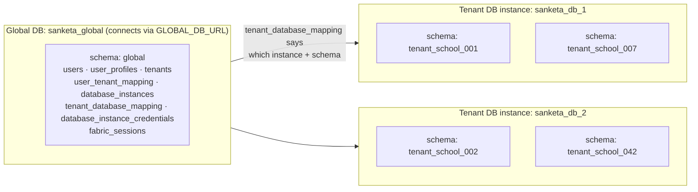
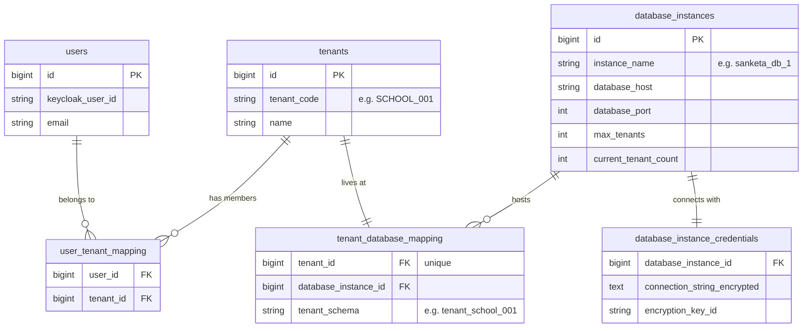
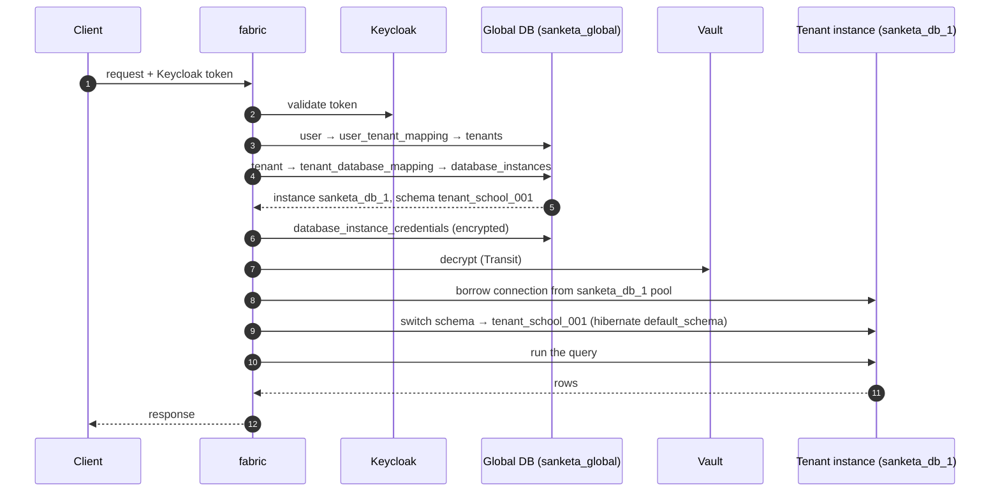
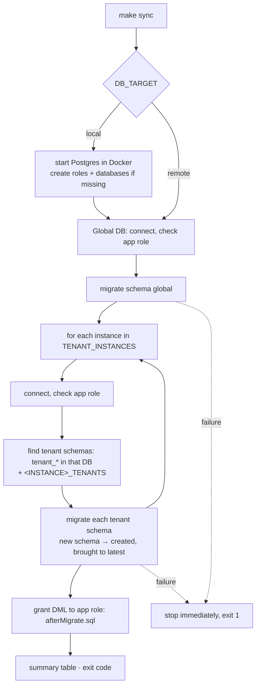
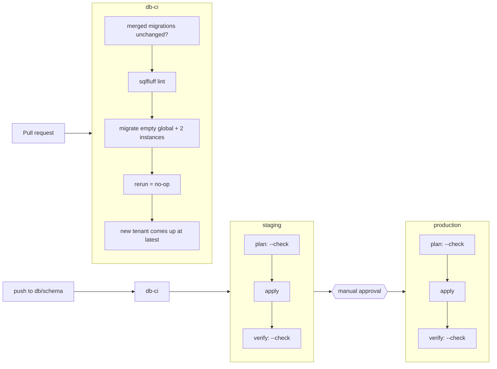

# sanketa-db

Source of truth for Sanketa's PostgreSQL schemas, versioned with Flyway.

- [Architecture](#architecture): what `fabric` expects and how this repo maps onto it
- [Bring every database up to date](#bring-every-database-up-to-date--one-command)
- [Configuration](#configuration)
- [CD pipeline](#cd-pipeline)
- [Rules that are enforced](#rules-that-are-enforced)

---

## Architecture

Sanketa is multi-tenant: one **tenant** per school. The data is split across two kinds of database, matching what the `fabric` service expects (`database/global_db_schema.sql` and `application.yml` in the backend repo).

### The two kinds of database



| | **Global DB** | **Tenant DB instance** |
|---|---|---|
| Name | `sanketa_global` | `sanketa_db_1`, `sanketa_db_2`, … (`database_instances.instance_name`) |
| How many | exactly one | as many as needed. Add instances to scale horizontally |
| Holds | identity (linked to Keycloak), the list of tenants, **routing**: which tenant lives where | **all school data**: students, teachers, academics, timetable, fees, … |
| Inside it | one schema: `global` | one schema **per school**: `tenant_<code>` (e.g. `tenant_school_001`) |
| Migrations | `migrations/global/` | `migrations/tenant/`, the same files on **every** tenant schema of **every** instance |
| App connects as | `sanketa_global_app` | `sanketa_tenant_app` |
| Migrator | `sanketa_global_migrator` | `sanketa_tenant_migrator` (can be overridden per instance) |

### The routing tables, all in the Global DB



- A **user** can belong to many **tenants**, e.g. a teacher at two schools (`user_tenant_mapping`).
- Each **tenant** lives in exactly one **instance**, in one **schema** (`tenant_database_mapping`). The pair (instance, schema) is unique.
- Each **instance** has capacity limits (`max_tenants`, `current_tenant_count`), so new schools go to an instance with room.
- Instance credentials are stored **encrypted** (`database_instance_credentials`) and decrypted through Vault.

### How a request finds its school's data (inside `fabric`)



`fabric` keeps **one connection pool per instance**, not per school (`sanketa.database.pool.max-size: 50`), and switches schema per request. That's why many schools share an instance cheaply.

### MySQL → PostgreSQL: one naming difference to know

| Concept | MySQL (old `fabric` SQL) | PostgreSQL (this repo) |
|---|---|---|
| Server | host:port | host:port |
| "Database" | **same thing as a schema** | a container that **holds schemas** |
| Global data | database `sanketa_global` | database `sanketa_global` → schema `global` |
| One school | database/schema `tenant_x` on an instance | schema `tenant_x` inside database `sanketa_db_N` |

So in Postgres a tenant instance is **host + port + database name**. `database_instances` today stores only host and port. When it's rewritten as a Postgres migration here, it needs a **`database_name`** column, and `database_type`/`database_port` defaults become `POSTGRESQL`/`5432`.

### Local setup: what `make sync` creates on your Mac

```
Docker container "sanketa-postgres"  (one server, standing in for several)
│   reachable from your Mac at localhost:5433
│
├── database sanketa_global                  ← Global DB
│     └── schema global
├── database sanketa_db_1                    ← tenant instance 1
│     └── schema tenant_school_001
└── database sanketa_db_2                    ← tenant instance 2
      └── schema tenant_school_002
```

Locally, the "instances" are separate databases on one server. In staging/prod each can be on a different host: only the config changes, not the code.

Isolation is real even locally. `sanketa_tenant_app` **cannot connect** to `sanketa_global`, `sanketa_global_app` cannot connect to any tenant instance, and neither role can create or alter tables.

---

## Bring every database up to date: one command

```bash
git checkout db/schema
cp .env.example .env      # first time only
make sync                 # = scripts/db-sync.sh
```



Example output:

```
SCOPE   DATABASE           SCHEMA                       STATUS
global  sanketa_global     global                       applied 1
tenant  sanketa_db_1       tenant_school_001            applied 1
tenant  sanketa_db_2       tenant_school_002            applied 1
tenant  sanketa_db_2       tenant_school_042            up to date
```

| Command | Does |
|---|---|
| `make check` (`db-sync.sh --check`) | Read-only. Exit **3** if anything is pending |
| `make sync` | Apply everything pending, everywhere |
| `make seed` (`--with-seeds`) | Sync + dev seed data (refused on remote targets) |
| `make tenant instance=sanketa_db_1 name=tenant_school_042` | Create/migrate one school on one instance |
| `db-sync.sh --instance sanketa_db_2` | Only that instance's tenants (plus global) |
| `make new scope=global\|tenant desc="…"` | New migration from the template |
| `make reset` | Wipe local data, sync from scratch |
| `make psql db=sanketa_db_1` | psql into a local database |
| `scripts/flyway.sh tenant sanketa_db_1 tenant_school_001 info` | Raw Flyway on one schema (`info`, `validate`, `repair`) |

Exit codes: `0` in sync · `1` failure · `2` bad usage · `3` pending (`--check`).

Requirements: **Docker only.** Flyway and psql run in containers. Optional: `pipx install sqlfluff` for `make lint`.

---

## Configuration

Local values live in `.env` (copied from `.env.example`, git-ignored). In CI/CD the same names come from GitHub environment variables and secrets. **Already-set variables always win over `.env`.**

| Group | Variables |
|---|---|
| Mode | `DB_TARGET` (`local`/`remote`), `DB_SSLMODE`, `LOCK_TIMEOUT`, `POSTGRES_VERSION` |
| Global DB | `GLOBAL_DB_HOST` `GLOBAL_DB_PORT` `GLOBAL_DB_NAME` `GLOBAL_SCHEMA` `GLOBAL_DB_MIGRATOR_USER` `GLOBAL_DB_MIGRATOR_PASSWORD` `GLOBAL_DB_APP_ROLE` |
| Tenant instances | `TENANT_INSTANCES=sanketa_db_1,sanketa_db_2` |
| Shared tenant defaults | `TENANT_DB_HOST` `TENANT_DB_PORT` `TENANT_DB_MIGRATOR_USER` `TENANT_DB_MIGRATOR_PASSWORD` `TENANT_DB_APP_ROLE` |
| Per-instance overrides | `<INSTANCE>_HOST` `_PORT` `_NAME` `_SSLMODE` `_MIGRATOR_USER` `_MIGRATOR_PASSWORD` `_APP_ROLE`, e.g. `SANKETA_DB_2_HOST` |
| Local only | `POSTGRES_PASSWORD`, `LOCAL_PORT` (5433 on your Mac → 5432 in Docker), `*_APP_PASSWORD`, `<INSTANCE>_TENANTS` |

An instance setting is resolved as `<INSTANCE>_X`, then `TENANT_DB_X`, then the built-in default. The database name defaults to the instance name.

---

## CD pipeline



- Workflows: `.github/workflows/db-ci.yml`, `db-cd.yml` (orchestration), `db-deploy.yml` (one environment).
- Only one deploy runs at a time, and a running migration is never cancelled.
- Manual run (**Actions → db-cd → Run workflow**): pick `staging`/`production` and `check`/`apply`.

### One-time GitHub setup

Create environments **staging** and **production**. On production: *Required reviewers*, and deployments limited to `db/schema`. Then per environment:

| Kind | Name | Example |
|---|---|---|
| variable | `GLOBAL_DB_HOST` | `global-db.prod.internal` |
| variable | `GLOBAL_DB_NAME` | `sanketa_global` |
| variable | `GLOBAL_DB_APP_ROLE` | `sanketa_global_app` |
| secret | `GLOBAL_DB_MIGRATOR_USER` / `GLOBAL_DB_MIGRATOR_PASSWORD` | |
| variable | `TENANT_INSTANCES` | `sanketa_db_1,sanketa_db_2` |
| variable | `TENANT_DB_APP_ROLE` | `sanketa_tenant_app` |
| variable | `SANKETA_DB_1_HOST`, `SANKETA_DB_2_HOST`, … | `tenant-db-1.prod.internal` |
| secret | `SANKETA_DB_1_MIGRATOR_USER` / `_PASSWORD`, … per instance | |
| variable *(opt)* | `DB_SSLMODE` (`require` default; `verify-full` recommended), `LOCK_TIMEOUT`, `*_PORT`, `*_NAME` | |
| variable *(opt)* | `DB_RUNNER` | self-hosted runner label, if the DBs are private |

**Adding an instance** means appending it to `TENANT_INSTANCES` and adding its `<INSTANCE>_HOST` and credentials. No workflow change is needed: `db-deploy` loads every matching variable and secret by name.

### What infra must provision per environment

`docker/postgres/bootstrap.sh` is the exact local equivalent. For each environment:

- **Global DB** `sanketa_global`, with `REVOKE ALL ON DATABASE … FROM PUBLIC` and `REVOKE ALL ON SCHEMA public FROM PUBLIC`
  - `sanketa_global_migrator`: `LOGIN`, `CONNECT, CREATE` on it
  - `sanketa_global_app`: `LOGIN`, `CONNECT`
- **Each tenant instance** `sanketa_db_N`, with the same revokes
  - its migrator: `LOGIN`, `CONNECT, CREATE`
  - `sanketa_tenant_app`: `LOGIN`, `CONNECT`
- App roles never get DDL. Their table grants come from `migrations/callbacks/afterMigrate.sql`, re-applied on every migrate.

---

## Repository layout

```
migrations/global/      V<utc-timestamp>__<desc>.sql (+ R__ for views/functions) → Global DB, schema global
migrations/tenant/      same rules → every tenant schema on every instance
migrations/callbacks/   afterMigrate.sql: app-role grants, every schema, every run
seeds/{global,tenant}/  R__*.sql, idempotent, local/CI only; own history table
templates/              header every migration starts from
scripts/                db-sync.sh (entrypoint) · lib.sh · flyway.sh · new-migration.sh · check-immutable.sh
docker/postgres/        bootstrap.sh: local roles + databases (reference for infra)
docs/                   CONVENTIONS.md (read before writing a table) · adr/
```

---

## Rules that are enforced

1. **Merged migrations are immutable.** CI fails on any modify/rename/delete of a merged `V*` file. Fix forward.
2. **Timestamp versions** (`V20261019153000__…`), so parallel branches never collide.
3. **No `clean`.** It's disabled in the runner and refused by `flyway.sh`. Local reset is `make reset`.
4. **Least privilege, per database.** Migrators run DDL; app roles do DML only, and only on their own kind of database.
5. **Bounded locking.** Every migration session sets `lock_timeout` (default `5s`) and fails fast instead of freezing traffic.
6. **Fail fast across the fleet.** The first failing schema stops the run, so a bad migration never spreads to the remaining schools.
7. **Seeds never reach prod.** They're refused on remote targets and tracked in `flyway_seed_history`.
8. **Credentials never in argv.** They're passed to containers via env only, and stay masked in CI.

## Releasing alongside the app

Order per release: **db-cd (global → every instance) → `fabric` rollout.** Every migration must work with the `fabric` version that's *currently* running (expand → migrate → contract; see `docs/CONVENTIONS.md`).

`fabric` changes needed for Postgres:
- `GLOBAL_DB_URL=jdbc:postgresql://<host>:5432/sanketa_global?currentSchema=global`, driver `org.postgresql.Driver`, connecting as `sanketa_global_app`
- tenant pools connect to each instance's **database** as `sanketa_tenant_app`; schema switching (`hibernate.default_schema`) stays as it is
- `spring.jpa.hibernate.ddl-auto=validate`, with Flyway disabled in the app
